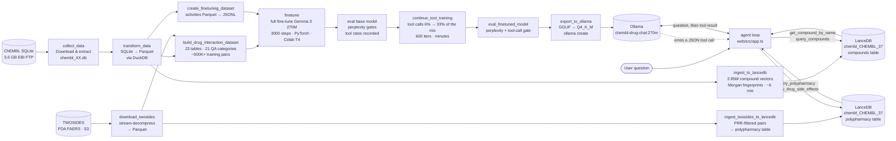

# chem_mlops

An end-to-end MLOps pipeline that fine-tunes a Gemma 3 270M language model on ChEMBL drug-interaction data, builds a 2.85 M-compound vector store, and serves the model as a **tool-calling agent** in a streaming web chat. Training is PyTorch (a free Colab T4 is enough); serving runs on any x86_64 or arm64 machine, small enough for a 1 GB VM.

The model does not have context injected into its prompt. It asks for the lookups it needs, the server runs them against LanceDB, and the results come back into the conversation.

---

## Overview



The pipeline is orchestrated with **Dagster** and runs entirely locally.

---

## Requirements

| Tool | Version |
|------|---------|
| Python | ≥ 3.13 |
| [uv](https://docs.astral.sh/uv/) | any |
| [Bun](https://bun.sh) | ≥ 1.3 |
| [Ollama](https://ollama.com) | any |
| [llama.cpp](https://github.com/ggml-org/llama.cpp) `llama-quantize` | any (for the Ollama export) |

> **Note:** Training uses PyTorch: CUDA (a Colab T4 is enough), Apple MPS, or CPU (slow). See [Train on Colab](#train-on-colab). **The evaluation step still uses `mlx-lm` and has not been ported yet**, so it cannot score new runs until it is.
>
> Python dependencies are split in `pyproject.toml`. The default set is only what the chat app's tools import (LanceDB, RDKit, Polars); the data pipeline, fine-tuning and Dagster live in the `train` group. A plain `uv sync` installs both (plus `dev`). The serving image installs just the default set with `uv sync --no-default-groups`.

---

## Installation

```bash
git clone https://github.com/AymanSulaiman/chem_mlops.git
cd chem_mlops
bash install.sh
```

`install.sh` is the single command from data to a running app. It needs macOS with Docker running, and a Hugging Face account that has accepted the [Gemma 3 license](https://huggingface.co/google/gemma-3-270m) (it prompts you to log in). It:

1. installs `uv`, `ollama`, `llama.cpp` and `aria2` via Homebrew and syncs Python dependencies
2. downloads ChEMBL with 16 parallel connections (EBI throttles each one to ~50 kB/s)
3. runs the Dagster pipeline: transform → datasets → LanceDB → fine-tune Gemma 3 270M → tool-call training → Q4_K_M export to Ollama
4. starts the Docker containers ([Docker](#docker)) and serves the chat at http://localhost:3000

The first run takes hours: the download, the dataset build, and above all fine-tuning (fastest on a GPU; on a Mac's GPU, expect many hours). Re-running it reuses the extracted ChEMBL data. The model isn't evaluated before export yet, because the eval step still uses MLX and is being ported.

**Manual setup** (if you prefer step-by-step):

```bash
brew install uv bun ollama llama.cpp aria2
uv sync
cd web && bun install && cd ..
```

Then run the pipeline manually — see [Pipeline](#pipeline) below.

---

## Pipeline

### Start the Dagster UI

```bash
dagster dev -w deployments/workspace.yaml
```

Open [http://localhost:3000](http://localhost:3000) to browse ops, trigger runs, and inspect logs. The `chembl_pipeline` job is pre-configured with a daily midnight UTC schedule.

### Run everything (headless)

```bash
uv run python -m app.orchestration.chembl_drug_chat_pipeline
```

This executes the full pipeline via Dagster:

1. Download ChEMBL SQLite archive
2. Convert all tables to Parquet
3. In parallel:
   - Download TWOSIDES polypharmacy dataset (FDA FAERS, Tatonetti et al.)
   - Build the QA JSONL dataset (ChEMBL + TWOSIDES)
   - Build the activity Parquet
   - **Ingest 2.85 M compounds into LanceDB** (vector store behind the agent's tools)
   - **Ingest TWOSIDES polypharmacy pairs into LanceDB**
4. Fine-tune Gemma 3 270M (full fine-tune)
5. **Evaluate the base model** — perplexity gates; golden and tool rates recorded only
6. **Continue that model on a tool-heavy mix** — minutes, into its own `<stamp>_tools` run
7. Evaluate the tool-trained model (perplexity + golden + tool-call) — gates Ollama export
8. Convert to GGUF, quantize to Q4_K_M and register the model with Ollama

Steps 4–8 pass the run directory explicitly between the ops. They used to each
look up "the latest run in `artifacts/`", which meant anything else writing
there could gate on one model and ship another.

**Why the base model is evaluated too** (step 5): without it, a bad number at
step 7 has two suspects — the base run or the continuation — and no way to tell
them apart once the run directory is gone. It also answers whether continued
training is earning its place, on every run rather than as a special
investigation. Its golden and tool-call gates are both disabled (thresholds of `0`):
that model carries tool records at ~6% of its mix and is not expected to clear
a tool-call or a lookup-dependent bar, and stopping the pipeline on a model
nobody ships is the mistake the golden gate used to make. Perplexity still gates there — continuing from a
regressed model is pointless, and it is better to find out before spending the
continuation.

**Nothing reaches Ollama before the gate.** `gemma3_chembl_toon_finetune_flow`
exports when run standalone, and the pipeline passes `export=False` so the only
model published is the tool-trained one, after step 7 passes.

### Build with the full dataset

```bash
# Step 1 — Download ChEMBL (~5.6 GB, ~5 min on a fast connection)
uv run python -m app.scripts.flows.initial_data_transformation.collect_data

# Step 2 — Convert SQLite → Parquet for all 74 tables (~10–20 min)
uv run python -m app.scripts.flows.initial_data_transformation.transform_data

# Step 3a — Build the QA finetuning dataset (~16–24 GB RAM recommended)
uv run python -m app.scripts.flows.llm_finetuning_data.build_drug_interaction_dataset

# Step 3b — Build the activity Parquet dataset
uv run python -m app.scripts.flows.llm_finetuning_data.build_finetune_dataset

# Step 3c — Ingest 2.85 M compounds into LanceDB (~6 min)
uv run python -m app.scripts.flows.vector_store.ingest_to_lancedb

# Step 3d — Download TWOSIDES from Tatonetti Lab S3 (~120 MB gzip, streamed)
uv run python -m app.scripts.flows.llm_finetuning_data.download_twosides

# Step 3e — Ingest TWOSIDES into the polypharmacy LanceDB table (run after 3c and 3d)
uv run python -m app.scripts.flows.vector_store.ingest_twosides_to_lancedb

# Step 4 — Fine-tune Gemma 3 270M (GPU recommended: see Train on Colab).
# Run standalone this also exports to Ollama when it finishes. The Dagster
# pipeline passes export=False so nothing is published before the gate.
uv run python -m app.scripts.flows.finetuning.finetuning

# Step 4b — Measure the base model before continuing, so a bad number later
# has one suspect rather than two. Thresholds of 0 record without gating.
uv run python -m app.scripts.flows.eval.eval_finetuned_model \
  --run-dir artifacts/<stamp> --tool-call-threshold 0 --pass-threshold 0

# Step 5 — Continue that model on a tool-heavy mix (~minutes).
# The full run's 60 K tool-call records compete with ~900 K prose ones answering
# the same questions from memory; this retrains on a mix where tool calls are a
# third of what the model sees. Writes a new artifacts/<stamp>_tools run and
# leaves the model it started from untouched.
uv run python -m app.scripts.flows.finetuning.continue_tool_training

# Step 6 — Evaluate the tool-trained run. This is the gate: it blocks the export
# on a perplexity regression or a tool-call parse rate below threshold.
uv run python -m app.scripts.flows.eval.eval_finetuned_model \
  --run-dir artifacts/<stamp>_tools

# Step 7 — Convert to GGUF, quantize to Q4_K_M, and register with Ollama.
# Pass the run you evaluated — otherwise this exports whichever run sorts last.
uv run python -m app.scripts.flows.finetuning.export_to_ollama \
  --run-dir artifacts/<stamp>_tools
```

Expected disk and time requirements:

| Step | Disk | Time (approx) |
|------|------|---------------|
| Download ChEMBL SQLite | 5.6 GB | ~5 min |
| Convert to Parquet | 8–10 GB | ~15 min |
| Build QA dataset | < 1 GB output | ~30–60 min |
| Ingest to LanceDB | ~15 GB | ~6 min |
| Download TWOSIDES | ~50 MB Parquet | ~2–3 min |
| Ingest TWOSIDES to LanceDB | < 100 MB | ~1 min |
| Fine-tune (3 000 steps) | ~1 GB model + ~3.5 GB checkpoint | not yet measured on a T4 |
| Evaluate base model | < 1 MB | ~10–15 min |
| Continue on tool mix (600 steps) | ~141 MB mix + ~1 GB model | not yet measured |
| Evaluate tool-trained model | < 1 MB | ~10–15 min |
| Export to Ollama | ~260 MB Q4_K_M GGUF | < 1 min |

> **Low-RAM machines:** Cap each table at N rows with `--row-limit`:
> ```bash
> uv run python -m app.scripts.flows.llm_finetuning_data.build_drug_interaction_dataset \
>   --row-limit 200000
> ```

---

## Web App

The repository includes a Bun chat app (`web/`): a single agentic pane where the fine-tuned model answers with **tools**. It asks for a ChEMBL or TWOSIDES lookup, the server runs it against LanceDB, and the result comes back into the conversation — nothing is injected unless a tool asked for it.

```
┌─────────────────────────────────────────────────────┐
│  Chem MLOps Chat        chembl-drug-chat:270m · tags│
├─────────────────────────────────────────────────────┤
│                    What is the MW of Aspirin?  [me] │
│                                                     │
│  get_compound_by_name({"name":"Aspirin"})           │
│  {"chembl_id":"CHEMBL25","mw_freebase":180.16,...}  │
│                                                     │
│  Aspirin (CHEMBL25) has a molecular weight of       │
│  180.16, formula C9H8O4.                            │
├─────────────────────────────────────────────────────┤
│  Ask about a drug, an interaction, or a structure…  │
└─────────────────────────────────────────────────────┘
```

| Tool | Backed by |
|------|-----------|
| `get_compound_by_name` | LanceDB `compounds` |
| `query_polypharmacy` / `query_drug_side_effects` | LanceDB `polypharmacy` (TWOSIDES) |
| `draw_molecule` | ChEMBL structure → RDKit `Draw.MolToImage` → PNG in the chat |
| `query_compounds` | Morgan-fingerprint similarity search — callable, but **not advertised to the model** (see below) |

The first four are the existing functions in `app/scripts/flows/vector_store/query_lancedb.py`, reached through the `app.scripts.flows.vector_store.tools` CLI. Ollama refuses its native `tools` field for this model (Gemma 3 has no tool template), so tool calls are emitted as bare JSON and parsed out of the reply. Each tool call and its result render as their own bubble, so the lookup is visible.

**The model is sent no system prompt.** Its training records are bare `### Question` / `### Answer` pairs with no tool list, so prepending one at inference is out-of-distribution text it copies from rather than reasons over — every "is it safe to take X with Y?" collapsed onto whichever tool example sat last in the list. Removing the system prompt took tool routing from 50% to 100% on held-out drugs. `query_compounds` is excluded for the same reason: it is the one tool with no training records, and advertising it made the model copy its example SMILES verbatim for unrelated questions. Both findings are recorded in ROADMAP item 3.

A near-miss tool name or argument key (`query_compound`, `drug_name` where the tool wants `name`) is mapped onto the real registry by `resolve_tool_call`, mirrored in `web/src/tools.ts` so the served behaviour and the measured behaviour cannot drift.

**Start the dev server (hot reload):**

```bash
cd web
bun run dev
```

Open [http://localhost:3000](http://localhost:3000).

**Production:**

```bash
cd web
bun run start
```

**Tests:**

```bash
cd web
bun test
```

A `web/.env` file with working defaults is committed — Bun loads it automatically, no setup needed. Edit it to point at a different Ollama host or override the model prefix.

---

## Docker

The chat app runs as two containers: the Bun server with the Python tool bridge, and Ollama with the fine-tuned model built in. This is the shape the GCP deployment uses. Building the data and training happen outside the containers (on your machine or on Colab); the containers only serve the result.

### Live run, end to end

`./install.sh` does all of the steps below in one command. To run them one at a time, start from the repo root. You need Docker, `uv`, and `llama.cpp` (`brew install llama.cpp`, used to quantize the model on export).

**1. Build the data** (once). The containers mount the LanceDB folder this produces; training reads the fine-tuning dataset.

EBI limits each connection to ~50 kB/s, so download the 5.8 GB ChEMBL archive with parallel connections first (~1–2 h instead of over a day). `collect_data` extracts it instead of downloading again:

```bash
brew install aria2
aria2c -x16 -s16 -d data https://ftp.ebi.ac.uk/pub/databases/chembl/ChEMBLdb/latest/chembl_37_sqlite.tar.gz
```

```bash
uv sync
uv run python -m app.scripts.flows.initial_data_transformation.collect_data
uv run python -m app.scripts.flows.initial_data_transformation.transform_data
uv run python -m app.scripts.flows.llm_finetuning_data.download_twosides
uv run python -m app.scripts.flows.llm_finetuning_data.build_drug_interaction_dataset   # add --row-limit 200000 for a quick pass
uv run python -m app.scripts.flows.llm_finetuning_data.build_finetune_dataset
uv run python -m app.scripts.flows.vector_store.ingest_to_lancedb
uv run python -m app.scripts.flows.vector_store.ingest_twosides_to_lancedb
```

**2. Train** (needs `huggingface-cli login` with the Gemma license accepted). On a Mac, time `--iters 50` first to estimate the full 3,000 steps, or [train on Colab](#train-on-colab) and copy `model/` back into `artifacts/<run>/`. Re-running the same command resumes.

```bash
uv run python -m app.scripts.flows.finetuning.finetuning --run-name local_v1 --no-export
uv run python -m app.scripts.flows.finetuning.continue_tool_training \
  --from-run artifacts/local_v1 --run-name local_v1_tools
```

**3. Export** to a Q4_K_M GGUF plus Modelfile in `artifacts/local_v1_tools/ollama/` (under a minute). The Ollama image is built from that folder.

```bash
uv run python -m app.scripts.flows.finetuning.export_to_ollama --run-dir artifacts/local_v1_tools
```

**4. Start the containers.**

```bash
MODEL_DIR=artifacts/local_v1_tools/ollama docker compose up --build
```

Open [http://localhost:3000](http://localhost:3000) and ask *"Is it safe to take warfarin with aspirin?"*. Working looks like a tool-call bubble (`query_polypharmacy`), the LanceDB result, then the answer. Stop with `Ctrl+C`; `docker compose down` removes the containers.

To check the model container alone:

```bash
docker compose exec ollama ollama run chembl-drug-chat:270m "Is it safe to take warfarin with aspirin?"
# expect: {"tool": "query_polypharmacy", "args": {...}}
```

To build the images the GCP VM runs (x86_64), prefix the command with `DOCKER_DEFAULT_PLATFORM=linux/amd64`. On Apple Silicon this runs under emulation and is slow.

Caveats:

- Skip the eval step for now: it still uses MLX and is being ported to Ollama.
- Some questions about well-known drugs are still answered from memory instead of with a tool call. Retraining tool calls fixes this.

### Images

`data/lancedb` is mounted read-only; set `LANCEDB_HOST_DIR` to mount a different folder and `CHEMBL_DB_NAME` (e.g. `chembl_CHEMBL_36`) to skip the folder scan.

| Image | Dockerfile | Size | Contents |
|-------|-----------|------|----------|
| web | `deploy/web.Dockerfile` (context: repo root) | ~1.6 GB | Bun, Python 3.13 with the default (serving) dependencies only, `app/` and `web/`, frontend prebuilt |
| ollama | `deploy/ollama.Dockerfile` (context: the model folder) | ~430 MB | Ollama binary and CPU libraries on Ubuntu, `chembl-drug-chat:270m` created at build time from the Q4_K_M GGUF |

Notes:

- The Ollama image is CPU only. It drops the ~3.5 GB of GPU libraries in the official image; for a GPU, base it on `ollama/ollama` unchanged.
- The image serves the GGUF exactly as exported (already Q4_K_M); it does not re-quantize.
- The model container uses ~620 MB RAM at `num_ctx 8192`.
- `OLLAMA_KEEP_ALIVE=-1` keeps the model loaded between requests.
- To publish a model for deployment: `BUCKET=<bucket> ./deploy/publish_model.sh artifacts/<run>` uploads the GGUF, Modelfile and a `manifest.json` to `gs://<bucket>/models/<run>/`.

---

## Vector Store

The pipeline builds a **LanceDB vector store** alongside fine-tuning — every molecule in ChEMBL, each small molecule represented as a 2048-bit Morgan fingerprint (ECFP4, radius 2).

**Biologics are in the table too, without a fingerprint.** Antibodies,
oligonucleotides and cell therapies have no SMILES, so they cannot be
fingerprinted — but they are real drugs with mechanisms, targets and
indications, and the name-lookup tools need to reach them. They are stored with
a zero vector and `has_structure = False`; `query_compounds` filters on that
flag, so a structureless row can never surface as a spurious "similar compound".
`draw_molecule` says so plainly rather than failing on a missing structure.

Excluding them used to mean no tool could answer a question about one — 15 of
the 40 drugs in the golden benchmark were simply unreachable. The old filter
also dropped ~22 K `structure_type = 'BOTH'` molecules, which *do* carry
structures and belong in similarity search.

**Why a vector store alongside fine-tuning?** Fine-tuning teaches the model to sound like a domain expert. It cannot guarantee factual accuracy for specific compounds. The store is what the agent's tools read, grounding answers in real ChEMBL records — mechanisms, indications, warnings, metabolic enzymes — that the model only needs to format.

### Ingest

```bash
# Runs automatically as part of the Dagster pipeline, or standalone:
uv run python -m app.scripts.flows.vector_store.ingest_to_lancedb
```

Re-runs are safe — the table is always overwritten. Output: `data/lancedb/chembl_CHEMBL_37/`.

Two environment variables move the store without code changes (both optional):

| Variable | Default | Effect |
|----------|---------|--------|
| `LANCEDB_DIR` | `data/lancedb` | Root folder holding `chembl_CHEMBL_*`. Used by ingest and query alike. |
| `CHEMBL_DB_NAME` | unset | e.g. `chembl_CHEMBL_37`. When set, queries connect straight to it instead of picking the latest folder, which avoids a directory listing per tool call on a mounted bucket. |

> **A store built before the `has_structure` column needs re-ingesting.**
> `query_compounds` filters on that column, and LanceDB errors on an unknown
> field rather than ignoring it, so similarity search fails against an older
> table until this runs. Name lookups are unaffected.

### Query — compounds

```python
from app.scripts.flows.vector_store.query_lancedb import query_compounds, get_compound

# Similarity search — top 5 compounds most similar to aspirin
hits = query_compounds("CC(=O)Oc1ccccc1C(=O)O", n=5)

# Exact lookup by ChEMBL ID
record = get_compound("CHEMBL25")
```

### Query — polypharmacy (TWOSIDES)

The `polypharmacy` table stores drug-pair adverse-event signals from TWOSIDES (Tatonetti et al., *Science Translational Medicine* 2012), derived from FDA FAERS co-reporting. Only pairs with PRR ≥ 3.0 and ≥ 5 reported cases are retained.

```python
from app.scripts.flows.vector_store.query_lancedb import query_polypharmacy, query_drug_side_effects

# Look up a specific drug pair (order-insensitive, case-insensitive)
pair = query_polypharmacy("Warfarin", "Aspirin")
# Returns dict with side_effects, max_prr, total_cases, n_side_effects — or None

# All known polypharmacy partners for a drug
pairs = query_drug_side_effects("Warfarin", n=20)
```

---

## QA Dataset

`build_drug_interaction_dataset` reads 23 ChEMBL tables plus TWOSIDES and emits 22 categories of training pairs in `### Question / ### Answer` format:

| # | Category | Source tables |
|---|----------|--------------|
| 1 | Mechanism of action | `drug_mechanism`, `target_dictionary` |
| 2 | Therapeutic indication | `drug_indication` |
| 3 | Metabolic pathways | `metabolism`, `target_dictionary` |
| 4 | Drug-drug interactions (with severity) | `metabolism` (shared CYP substrates) |
| 5 | Bioactivity potency | `activities` (pChEMBL values) |
| 6 | Drug warnings | `drug_warning` |
| 7 | Drug synonyms | `molecule_synonyms` |
| 8 | Physicochemical properties | `compound_properties` |
| 9 | ATC classification | `atc_classification`, `molecule_atc_classification` |
| 10 | Approved products | `formulations`, `products` |
| 11 | Scientific literature | `docs` |
| 12 | Assay context | `assays`, `activities` |
| 13 | Ligand efficiency | `ligand_eff`, `activities` |
| 14 | Protein target sequences | `component_sequences`, `target_components` |
| 15 | Protein family | `protein_classification`, `component_class`, `target_components` |
| 16 | Biotherapeutics | `biotherapeutics` |
| 17 | Target relations | `target_relations` |
| 18 | CYP inhibition (quantitative) | `activities`, `assays`, `target_dictionary` (IC50/Ki) |
| 19 | Pharmacodynamic interactions | `drug_mechanism`, `target_dictionary` (shared receptors) |
| 20 | P-glycoprotein transport | `activities`, `assays`, `target_dictionary` (ABCB1/MDR1) |
| 21 | Polypharmacy side effects | TWOSIDES (FDA FAERS · PRR-filtered drug-pair adverse events) |
| 22 | Tool calls | question → JSON tool call → tool result → answer, over categories 1/8/21 |

Category 22 teaches the agent behaviour: each record carries both turns — the
call the model should emit, and the prose answer it should give once the result
comes back — laid out byte-identically to what the server sends at inference.

**Molecules are held out before generation.** 200 ChEMBL IDs are excluded from
every generator, and `golden.jsonl` is rebuilt from exactly those molecules in
the same run, so the benchmark and the training set cannot drift into overlap.
The holdout lands in `data/llm_finetune/holdout.json`.

Output: `data/llm_finetune/train.jsonl` (90%) and `valid.jsonl` (10%).

Each record:
```json
{"text": "### Question\nWhat does Aspirin target?\n\n### Answer\nAspirin (CHEMBL25) inhibits Cyclooxygenase-1 ..."}
```

**CLI options:**

```bash
uv run python -m app.scripts.flows.llm_finetuning_data.build_drug_interaction_dataset \
  [--data-dir PATH]   # default: data/chembl_transform
  [--output-dir PATH] # default: data/llm_finetune
  [--row-limit N]     # cap every table at N rows (useful on low-RAM machines)
  [--workers N]       # parallel generator processes (default: CPU count)
```

---

## Fine-tuning

Fine-tuning is a **full fine-tune** of **Gemma 3 270M** (`google/gemma-3-270m`) with the Hugging Face `Trainer`. At 270M parameters the whole model plus optimizer state is ~4.5 GB, so there is no LoRA adapter and no merge step. The served model is ~260 MB at Q4_K_M, which is what makes a 1 GB VM possible.

| Parameter | Value |
|-----------|-------|
| Method | Full fine-tune |
| Batch size | 1 × 16 gradient accumulation (effective 16; larger batches run out of memory: the 262k-token vocabulary makes the logits huge) |
| Steps | 3 000 |
| Learning rate | 5e-5, cosine |
| Max sequence length | 1 024 |
| Precision | bf16 on Ampere+, fp32 on a T4 (Gemma overflows in fp16) |
| Gradient checkpointing | ✓ |

Artifacts are written to `artifacts/<run>/`:

```
artifacts/<run>/
├── checkpoints/checkpoint-N/   # latest only; resume point after a disconnect
├── model/                      # fine-tuned model (Hugging Face format)
├── logs/train_log.json         # loss and eval loss per report step
└── ollama/                     # chembl-drug-chat.gguf (Q4_K_M) + Modelfile, after export
```

Re-running with the same `--run-name` resumes from the checkpoint.

### Train on Colab

The dataset build needs 16–24 GB RAM, more than free Colab has, so build `data/llm_finetune/` locally and train on Colab.

1. Accept the Gemma license at [huggingface.co/google/gemma-3-270m](https://huggingface.co/google/gemma-3-270m) and create a read token.
2. Copy `data/llm_finetune/train.jsonl` and `valid.jsonl` to Google Drive at `MyDrive/chem_mlops/data/llm_finetune/`.
3. Make the code reachable from Colab (push the `gcp_deployable` branch, or upload the repo).
4. In a notebook with **Runtime → Change runtime type → T4 GPU**:

```python
from google.colab import drive
drive.mount("/content/drive")
D = "/content/drive/MyDrive/chem_mlops"
!git clone -b gcp_deployable https://github.com/AymanSulaiman/chem_mlops.git /content/chem_mlops
%cd /content/chem_mlops
# Data and runs live on Drive, so a disconnect loses nothing.
!mkdir -p {D}/artifacts && ln -sfn {D}/data data && ln -sfn {D}/artifacts artifacts
!pip install -q "accelerate>=1.0.0" "transformers>=4.57.1"
from huggingface_hub import login; login()
```

```python
!python -m app.scripts.flows.finetuning.finetuning --run-name gemma270m_v1 --no-export
!python -m app.scripts.flows.finetuning.continue_tool_training \
    --from-run artifacts/gemma270m_v1 --run-name gemma270m_v1_tools
```

If the session drops, run the setup cell again and repeat the same command; it resumes from the last checkpoint. Colab runs Python 3.12; the training code runs from source there without installing the project, so the repo's 3.13 pin doesn't apply.

5. Download `MyDrive/chem_mlops/artifacts/gemma270m_v1_tools/model/` into `artifacts/gemma270m_v1_tools/model/` locally, then export:

```bash
uv run python -m app.scripts.flows.finetuning.export_to_ollama --run-dir artifacts/gemma270m_v1_tools
```

Checkpoints hold optimizer state (~3.5 GB each); delete `checkpoints/` on Drive once a run finishes.

### Continuing a run on tool calls

A full run trains ~950 K records, in which the 60 K tool-call examples compete
with ~900 K prose ones answering the same question shapes from memory.
`continue_tool_training.py` does the cheap experiment instead: it continues an
existing model on a mix where tool calls are a third of what the model sees,
writing to a **new** run directory so the source model is untouched.

```bash
uv run python -m app.scripts.flows.finetuning.continue_tool_training

# Build the mix and stop, to inspect it:
uv run python -m app.scripts.flows.finetuning.continue_tool_training --mix-only
```

Minutes rather than hours. Measure before exporting — it skips the export step
deliberately:

```bash
uv run python -m app.scripts.flows.eval.eval_finetuned_model --run-dir <new run>
```

### Rebuilding the agent end to end

The Dagster pipeline runs all of this (steps 4–7 above). Do it by hand when you
already have the dataset and only the models are missing — `artifacts/` is
gitignored, so a fresh clone or a lost run directory needs the sequence without
re-downloading ChEMBL. `data/llm_finetune/` is the expensive input and is reused.

```bash
# 1. Full run (GPU recommended). Skip if you still have a model to continue from.
uv run python -m app.scripts.flows.finetuning.finetuning

# 2. Continue it on the tool-heavy mix (minutes). Writes artifacts/<stamp>_tools.
uv run python -m app.scripts.flows.finetuning.continue_tool_training

# 3. Measure. One at a time — see the warning under Model Evaluation.
uv run python -m app.scripts.flows.eval.eval_finetuned_model \
  --run-dir artifacts/<stamp>_tools

# 4. Export the model you measured, so the served model is the measured model.
uv run python -m app.scripts.flows.finetuning.export_to_ollama \
  --run-dir artifacts/<stamp>_tools
```

**What step 3 should print.** On the last run of this pipeline, all four tool
rates came back at 100% over 40 calls on held-out drugs:

```
Running tool-call benchmark (10 held-out drugs) ...
  Parsed 100.0% · known tool 100.0% · right tool 100.0% of 40

Running tool-result benchmark (10 held-out drugs) ...
  Used the result 100.0% · answered in prose 100.0% of 40
```

`build_tool_mix` samples with a fixed seed, so step 2 trains on the same mix
each time and these numbers should reproduce. **Routing — "right tool" — is the
one to watch.** If it comes back near 50% rather than 100%, a system prompt has
found its way back into the inference path; that single change was the
difference between the two figures. It happened again through a `SYSTEM` block
in the exported Modelfile, which Ollama prepends to every chat: 0/8 tool calls
with it, 4/8 without. The export no longer writes one. Golden staying at ~2–5% is expected and is
not a regression — see Model Evaluation below for why it is not gated.

Step 4 is what makes the served model the one you measured. Until it runs,
`ollama run chembl-drug-chat:270m` is whatever was exported last.

---

## Model Evaluation

> **Not yet ported off MLX.** The evaluation below still loads `mlx-lm` and the old adapter layout, so it cannot score runs from the PyTorch training above. It is being moved to Ollama (the served, quantized model) plus `transformers` for perplexity.

After fine-tuning, an evaluation step runs automatically before Ollama export.
Four signals, two of which block the export:

| Signal | Measures | Gated |
|--------|----------|-------|
| **Perplexity** on `valid.jsonl` | Did the fine-tune regress against the base model? | ✓ |
| **Golden benchmark** | 40 questions on held-out molecules, answered through the agent loop | ✓ pass rate |
| **Tool-call benchmark** | Given a question a tool can answer, does it emit a valid call for the right tool? | ✓ parse rate |
| **Tool-result benchmark** | Handed a tool result, does it read it or echo its shape? | — |

**Golden runs through the agent loop.** Every question asks for a fact about a
molecule deliberately excluded from training, so it cannot be answered from
weights — it is a *lookup*, and the model's job is to go and get it. One turn to
ask, the tool actually runs, and the answer written from the result is scored.
`golden_tool_used_count` records how often it asked: a low pass rate with a low
count is a routing problem, a low pass rate with a high count is a reading or
data problem.

It is also **the only gate on answer quality** — perplexity and the tool-call
rate would both pass a model that routes perfectly and then writes nonsense from
the result it was handed. A threshold of `0` disables a gate, which is how the
pipeline measures the intermediate base model without blocking on a model
nobody ships.

The tool-call benchmark takes its drugs from `golden.jsonl`, so both are scored
on molecules absent from `train.jsonl` — a test in the suite enforces that, by
ChEMBL ID rather than by eye.

Results are written to `data/eval/<run>/`:

```
data/eval/<run>/
├── finetuned_eval_metrics.json         # perplexity, every rate, which gates ran
├── finetuned_golden_results.jsonl      # per-question detail
├── finetuned_tool_call_results.jsonl   # per-call: named tool, resolved tool, args
└── finetuned_tool_result_results.jsonl # per-answer: expected marker, grounded, prose
```

`gates_applied` and `ungated_metrics` in the metrics file name what
`eval_gate_passed` actually covers, so a green flag is never read as "every
number is good".

To run evaluation standalone:

```bash
uv run python -m app.scripts.flows.eval.eval_finetuned_model

# A specific run, and a stricter tool-call gate:
uv run python -m app.scripts.flows.eval.eval_finetuned_model \
  --run-dir artifacts/20260403_220717 --tool-call-threshold 0.8
```

> **Do not run two evaluations at once.** They both spawn `mlx_lm generate`, and
> one will exhaust the GPU while the other returns empty completions. `_generate`
> raises on an empty completion rather than scoring it as a wrong answer — before
> that, a starved run reported "0.0% routing", which is indistinguishable from a
> real regression. You still lose the run, you just find out immediately.

---

## Loading into Ollama

```bash
brew install ollama llama.cpp

# Auto-detect the latest run and export:
uv run python -m app.scripts.flows.finetuning.export_to_ollama

# Target a specific run:
uv run python -m app.scripts.flows.finetuning.export_to_ollama --run-dir artifacts/<run>

# Force-overwrite an existing export, or keep F16 instead of Q4_K_M:
uv run python -m app.scripts.flows.finetuning.export_to_ollama --force --quantize ''
```

The export converts `model/` to an F16 GGUF, quantizes it to Q4_K_M with llama.cpp's `llama-quantize`, writes a Modelfile and registers `chembl-drug-chat:270m` with Ollama. The quantized GGUF is the file that ships, so the deployed model is byte-for-byte the one registered here. (Ollama 0.40 can only quantize safetensors imports, and that path does not support Gemma 3, hence llama.cpp.)

The Modelfile has **no system prompt**: the model is trained on bare `### Question` / `### Answer` text, and a baked-in `SYSTEM` block is prepended to every chat. It uses a relative `FROM ./chembl-drug-chat.gguf`, so `artifacts/<run>/ollama/` is portable: copy both files anywhere and `ollama create chembl-drug-chat:270m -f Modelfile` rebuilds the same model.

**Publish a model** to Cloud Storage for the deployed service, after evaluating and exporting a run:

```bash
BUCKET=<bucket> ./deploy/publish_model.sh artifacts/<run>
```

This uploads the GGUF, the Modelfile and a `manifest.json` (run, git commit, GGUF checksum, eval metrics from `data/eval/<run>/` if present) to `gs://<bucket>/models/<run>/`. Requires `gcloud`.

**Chat directly via Ollama:**

```bash
ollama run chembl-drug-chat:270m
```

Example questions:

```
>>> What does Aspirin target?
>>> How is Warfarin metabolised?
>>> What are the black box warnings for Methotrexate?
>>> Which drugs share the CYP2C9 metabolic pathway with Warfarin?
>>> What is the ligand efficiency of Imatinib?
>>> Is Adalimumab a small molecule or a biologic?
```

---

## Project structure

```
chem_mlops/
├── .github/workflows/ci.yml               # Lint + typecheck + pytest + bun test on every push/PR
├── app/
│   ├── orchestration/
│   │   └── chembl_drug_chat_pipeline.py   # Dagster pipeline (@op / @graph / Definitions)
│   ├── scripts/flows/
│   │   ├── initial_data_transformation/
│   │   │   ├── collect_data.py            # Download ChEMBL SQLite
│   │   │   └── transform_data.py          # SQLite → Parquet (DuckDB)
│   │   ├── llm_finetuning_data/
│   │   │   ├── build_drug_interaction_dataset.py  # 21-category QA builder (parallel)
│   │   │   ├── build_finetune_dataset.py          # Activity Parquet → JSONL
│   │   │   └── download_twosides.py               # Stream-download TWOSIDES → Parquet
│   │   ├── finetuning/
│   │   │   ├── finetuning.py              # Full fine-tune (PyTorch, Hugging Face Trainer)
│   │   │   ├── continue_tool_training.py  # Continue a model on a tool-heavy mix
│   │   │   ├── convert_gemma3_gguf.py     # Hugging Face weights → F16 GGUF
│   │   │   └── export_to_ollama.py        # GGUF → Q4_K_M → Ollama
│   │   ├── eval/
│   │   │   ├── eval_finetuned_model.py    # Perplexity + tool-call/result + golden benchmarks
│   │   │   └── golden.jsonl               # 40 questions, built from held-out molecules
│   │   └── vector_store/
│   │       ├── ingest_to_lancedb.py       # 2.85 M compounds → Morgan fingerprints → LanceDB
│   │       ├── ingest_twosides_to_lancedb.py  # TWOSIDES → polypharmacy table
│   │       ├── query_lancedb.py           # query_compounds / get_compound / polypharmacy API
│   │       └── tools.py                   # Tool CLI the web agent calls (adds draw_molecule)
│   └── tests/                             # pytest suite for each pipeline stage
├── web/                                   # Bun chat app
│   ├── src/
│   │   ├── app.ts                         # Request handler, agent loop, model detection
│   │   ├── tools.ts                       # Tool specs, tool-call parsing, name/arg resolver
│   │   ├── frontend.ts                    # Single-pane chat UI, tool-call rendering
│   │   └── frontend-helpers.ts            # renderMarkdown, formatReplyText (no DOM deps, testable)
│   ├── public/
│   │   ├── index.html                     # Single-pane agentic chat layout
│   │   └── style.css
│   ├── test/                              # bun test suite
│   └── server.ts                          # Bun.serve entry point + frontend build step
├── data/
│   ├── chembl_transform/                  # Parquet files (one per ChEMBL table)
│   ├── llm_finetune/                      # train.jsonl / valid.jsonl
│   ├── lancedb/chembl_CHEMBL_37/          # compounds (small molecules + biologics) + polypharmacy
│   └── twosides/TWOSIDES.parquet          # PRR-filtered FAERS pairs (~50 MB, gitignored)
├── deploy/
│   ├── web.Dockerfile                     # Chat app image (Bun + serving Python deps)
│   ├── ollama.Dockerfile                  # CPU-only Ollama with the model baked in
│   └── publish_model.sh                   # Upload GGUF + Modelfile + manifest to GCS
├── compose.yaml                           # Run both images locally
├── deployments/workspace.yaml             # Dagster code-location config
├── ROADMAP.md                             # Ranked work items, with what was measured
├── artifacts/                             # Fine-tuning run outputs (gitignored)
├── install.sh                             # One-command installer for Apple Silicon Macs
└── pyproject.toml
```

---

## Development

```bash
# Python tests
uv run pytest

# Lint
uv run ruff check .

# Type check
uv run ty check

# Web tests
cd web && bun test
```

All checks run automatically on every push and pull request via `.github/workflows/ci.yml`.

---

## Data sources

- **ChEMBL** — European Bioinformatics Institute. [ebi.ac.uk/chembl](https://www.ebi.ac.uk/chembl/)
- **TWOSIDES** — Tatonetti et al., *Science Translational Medicine* 2012. Drug-pair adverse event signals derived from FDA FAERS co-reporting, hosted by the Tatonetti Lab at Columbia University.
